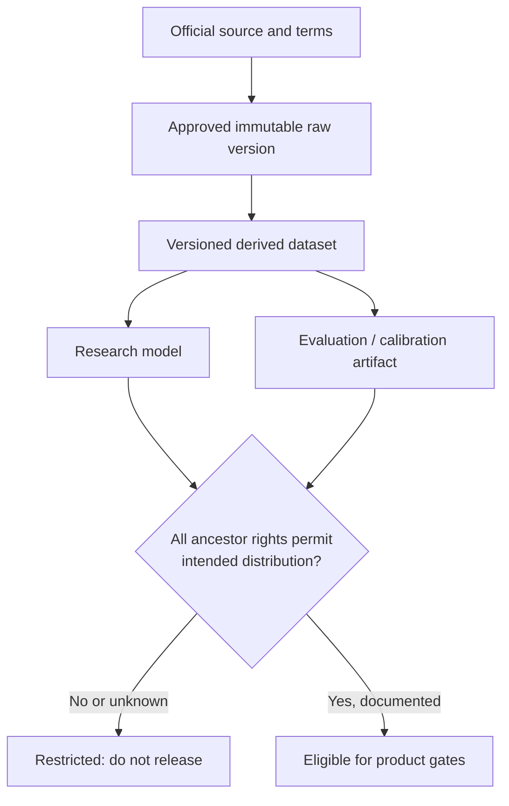

# Dataset Governance Standard

**Milestone:** 1.1 Dataset Validation  
**Last reviewed:** 2026-08-04  
**Applies to:** Raw datasets, annotations, derived assets, splits, evaluation results, and models with dataset lineage  
**Related:** [Dataset Comparison](DATASET_COMPARISON.md) · [Dataset Recommendation](DATASET_RECOMMENDATION.md) · [Dataset References](DATASET_REFERENCES.md) · [Architecture](../ARCHITECTURE.md)

## 1. Purpose

This standard defines how EmotionSense AI must approve, handle, document, and retire FER datasets. It supports the project’s privacy-first, offline architecture without authorizing dataset acquisition in this milestone. It follows the dataset-documentation principles of Datasheets for Datasets [D25] and model-lineage reporting principles of Model Cards [D26].

### Facts

- Several scientifically valuable FER datasets are limited to non-commercial research; access alone is not a license to distribute images or models [D07], [D10], [D13].
- FER datasets frequently contain web-sourced faces, uncertain consent provenance, demographic imbalance, label disagreement, and cross-dataset domain shift [D08], [D19]–[D21].
- A model can retain legal and ethical dependencies on every dataset used in training, fine-tuning, calibration, threshold selection, or evaluation.

### Assumptions

- EmotionSense AI may eventually be distributed through commercial app stores, so commercial and derived-model rights must be explicit.
- Raw face imagery is treated as highly sensitive project data even when publicly downloadable.
- Production processing will remain on-device; research data governance must be at least as strict as the product’s privacy claim.

### Trade-offs

- Strong governance slows dataset onboarding but prevents irreproducible experiments and unusable model lineages.
- Retaining detailed manifests improves auditability, while retaining unnecessary face imagery increases privacy and security exposure.

### Open questions

- Which organization or named role will act as data controller, license owner, and legal approver?
- What jurisdictional privacy and biometric-data rules apply to the research organization and intended markets?

## 2. Non-negotiable approval gates

A dataset must not be downloaded, opened, processed, or used until all applicable gates pass. Milestone 1.1 performs documentation only and therefore does not initiate this workflow.

| Gate | Required evidence | Approver |
|---|---|---|
| Scientific relevance | Defined role, target label ontology, expected benefit, and alternative considered | Research lead |
| Provenance | Official source, creator/institution, paper, collection method, version, and access date | Dataset steward |
| License | Full operative terms; permitted purposes; commercial, derived-model, redistribution, publication, retention, and termination clauses | Legal/license owner |
| Ethics/privacy | Consent provenance, sensitive attributes, vulnerable groups, intended use, and risk assessment | Privacy/ethics owner |
| Security | Storage location, access group, encryption, logging, backup, and deletion plan | Security owner |
| Evaluation design | Split policy, leakage controls, fairness slices, metrics, and target-domain limitations | Evaluation owner |

**Default-deny rule:** missing, ambiguous, conflicting, expired, or mirror-only terms fail the license gate. “For research” does not imply commercial use; an open-source annotation license does not establish rights to underlying images.

## 3. Dataset register and provenance

Every source and every derived version must have a unique immutable identifier. The register must contain at least:

- dataset name, upstream version/release, local dataset ID, and lifecycle state;
- owning institution, official URL, request date, approval date, and named custodian;
- original paper and required citations;
- collection purpose, acquisition method, countries/languages/search terms where known;
- image, sequence, subject, and class counts, including unknown values;
- label definitions, annotator count/type, agreement or confidence data, and quality-control procedure;
- documented demographic and capture-condition distributions, with “unknown” recorded explicitly;
- official and local split definitions, subject-independence evidence, and known duplicate risk;
- full license/agreement filename, version, effective date, expiry/termination conditions, and cryptographic checksum;
- permitted uses: viewing, preprocessing, training, fine-tuning, calibration, evaluation, publication, commercial use, weight distribution, and redistribution;
- storage path, access group, retention date, deletion instructions, and incident contact;
- raw and manifest checksums; transformation and descendant model IDs;
- known limitations, bias findings, unresolved questions, and approving signatures.

### Provenance rules

1. Obtain data only from the creator’s official channel or an explicitly authorized distributor.
2. Do not substitute Kaggle, GitHub, cloud-drive, or package-manager mirrors unless the rights holder identifies that mirror as authoritative.
3. Preserve source filenames and annotation values in an immutable raw layer; corrections belong in a versioned overlay.
4. Record uncertainty. Do not invent subject counts, demographics, consent, or license permissions where a source is silent.
5. A cleaned, relabeled, aligned, or reformatted copy is a new derived dataset and must point to every ancestor.

## 4. Licensing, citation, and model lineage

### License review checklist

The executed terms must answer:

- Who owns the images, annotations, metadata, and landmarks?
- Are research, educational, commercial, and production uses distinguished?
- Does permission cover training, fine-tuning, calibration, benchmarking, and publication?
- May derived model weights be stored, distributed inside an offline app, updated, sublicensed, or monetized?
- Are screenshots, example images, thumbnails, embeddings, crops, or statistics publishable?
- Is redistribution to collaborators, CI systems, contractors, or cloud providers allowed?
- Are attribution text, paper citations, notices, usage reports, or approval renewals required?
- Are geography, institution, single-site, named-user, security, retention, or deletion limits imposed?
- What happens to derived data and models when access ends or consent/license is revoked?

The register must quote only the minimal operative clause needed internally and link or attach the complete agreement. This document is not legal advice; ambiguous terms require qualified review.

### Citation requirements

- Store the required canonical citation supplied by the creator.
- Cite both the dataset paper and official source in research reports.
- Include dataset version/access date and any mandatory acknowledgement.
- Never imply endorsement by a dataset creator.
- Keep the consolidated bibliography in [DATASET_REFERENCES.md](DATASET_REFERENCES.md) synchronized with approved sources.

### Lineage inheritance

Any model, calibration file, threshold, benchmark artifact, or derived annotation must link to its dataset ancestors. Until legal review says otherwise, an artifact inherits the **most restrictive or unresolved** condition in its ancestry. Deleting raw images does not automatically remove restrictions from trained weights.

## 5. Storage, access, and privacy

### Storage policy

- Do not commit raw images, archives, annotations containing sensitive metadata, access credentials, or signed agreements to Git.
- Store restricted datasets only in an approved encrypted research location, separated by dataset and version.
- Do not place face datasets in personal cloud-sync folders, unmanaged removable media, public object stores, CI caches, crash reports, or analytics systems.
- Keep immutable raw data read-only. Store derived crops, alignments, quality filters, and split manifests separately.
- Backups must be explicitly allowed by the agreement, encrypted, access-controlled, inventoried, and included in deletion procedures.
- Minimize retained data. If a reproducible manifest and authorized redownload are sufficient, do not retain extra copies.
- Never use research images as documentation illustrations, test fixtures, or demos unless the exact publication use is licensed and approved.

### Access controls

- Grant least-privilege, named-user access; shared accounts are prohibited.
- Require agreement acceptance before access and remove access promptly on role change or departure.
- Separate permission to view raw imagery from permission to use approved derived features or aggregate results.
- Record access grants, exports, and deletions. Logs must not contain face images or sensitive metadata.
- Contractors, external collaborators, cloud services, and automated agents count as third parties unless the terms explicitly say otherwise.

### Privacy principles

- Public visibility does not eliminate privacy risk or create informed consent for expression inference.
- Do not attempt to identify subjects, link identities across datasets, infer sensitive traits, or contact depicted people.
- Do not infer ethnicity, gender identity, health, or emotional state from appearance for dataset completion.
- Use self-described demographic metadata for a future target corpus where ethically and legally appropriate; allow “prefer not to say.”
- Facial-expression labels must be documented as observer judgments of visible display, not ground truth internal emotion [D21].

## 6. Integrity and version control

### Integrity verification

- Compute a cryptographic checksum, such as SHA-256, for the original archive, license, annotations, and every approved split manifest [D27].
- Verify file counts, schema, class totals, invalid files, and missing annotations against the official release documentation.
- Quarantine corrupt or unexpected files; do not silently repair the raw layer.
- Later duplicate/near-duplicate and identity-overlap audits must be performed only when the license permits and must not create an identification database.
- Record tool, parameter, and reviewer for every integrity or quality decision.

### Dataset versioning

Use immutable semantic identifiers such as `affectnet/<upstream-version>/<project-derivation-version>`. Version changes include:

- upstream additions, removals, corrections, or changed terms;
- label mapping or ambiguity policy changes;
- crop/alignment/quality-filter changes;
- split, duplicate, or identity-group changes;
- excluded-file or fairness-metadata changes.

Version small manifests and documentation in the approved research metadata system; do not version restricted images in Git. Each experiment must pin exact dataset, derived version, ontology version, and split checksum.

### Change control

No dataset version is overwritten. Corrections produce a new version, changelog, impact analysis, and—where evaluation evidence changes—new results. A changed license triggers reapproval before further use.

## 7. Reproducibility requirements

Every experiment report must contain:

- dataset and derived-version IDs with checksums;
- approved use case and license-register reference;
- exact train, validation, calibration, and test manifests;
- subject/identity grouping approach and duplicate-handling policy;
- original-to-project label mapping, excluded labels, and vote-to-target policy;
- image transformation specification without embedding restricted example data;
- class counts before and after exclusions;
- random seeds and deterministic/non-deterministic operations;
- model/configuration identifier and software/environment versions when implementation begins;
- per-source metrics, uncertainty intervals, and known invalid comparisons;
- reviewer, date, exceptions, and links to the dataset/model cards.

The official test or target-domain release holdout must not be used for training, model selection, hyperparameter search, calibration fitting, or threshold selection. Repeated human inspection of holdout errors is also a form of adaptation and must be logged.

## 8. Fairness and robustness evaluation protocol

### Protocol design

Before evaluation, define the intended population and minimum performance evidence. The protocol must include:

1. **Identity independence:** no subject in more than one train/tune/test partition where identity can be established lawfully.
2. **Source separation:** report results per dataset and target domain; do not hide domain failure in a pooled average.
3. **Class performance:** macro F1, unweighted average recall, per-class precision/recall, confusion matrices, and sample counts.
4. **Calibration:** calibration curves plus ECE and Brier/log loss where valid; report accuracy/error against coverage for abstention.
5. **Capture slices:** device tier/camera, resolution or face size, lighting, head pose, occlusion, motion blur, compression, and expression intensity/ambiguity where annotated.
6. **Demographic slices:** consented age bands, self-described gender, geography/cultural context, and an ethically selected skin-tone measure for the target corpus. Do not treat inferred race labels as unquestioned truth.
7. **Intersectionality:** evaluate intersections where sample sizes support a responsible estimate; publish sample size and uncertainty rather than unstable rankings.
8. **Disparity measures:** compare per-class error, false high-confidence rate, calibration, and abstention coverage—not accuracy alone [D20].
9. **Uncertainty:** bootstrap or appropriate confidence intervals; predefine minimum sample sizes and suppress misleading tiny-slice estimates.
10. **Failure review:** document qualitative failure categories using licensed/consented examples or privacy-preserving aggregate descriptions.

### Release fairness gate

A release candidate requires a locked target-domain smartphone holdout. Public FER benchmarks cannot prove launch-population fairness because their demographic provenance and device distributions are incomplete. Thresholds for acceptable overall and worst-slice performance, calibration, coverage, and disparity must be approved before the holdout is opened.

### Assumptions

- Initial intended users include East African populations insufficiently characterized by the required public datasets.
- The application will expose an unavailable/low-confidence state rather than force a class on every frame.

### Trade-offs

- Collecting self-described attributes improves auditing but increases privacy risk and consent complexity.
- Intersectional analysis is more informative but needs substantially larger samples.
- A single shared confidence threshold is maintainable but may produce uneven calibration; slice-specific thresholds risk encoding protected attributes into runtime behavior and need separate ethical review.

### Open questions

- What launch population and minimum per-slice sample sizes will be approved?
- Which skin-tone measurement is ethical, reproducible, and relevant to camera performance?
- What maximum disparity and false-high-confidence rates are acceptable?
- Will minors be excluded from the initial product and target corpus?

## 9. Documentation artifacts

Every approved dataset must have a dataset card containing:

- motivation, composition, collection, preprocessing, labeling, uses, and exclusions;
- license, consent, privacy, security, and retention summary;
- demographic and capture-condition evidence with explicit unknowns;
- known biases, annotation agreement, class imbalance, and quality failures;
- official and project split definitions;
- ontology mappings and source-label preservation;
- integrity hashes, version history, contact, and approval status;
- models and reports that depend on the version.

Every candidate model card must list all training, fine-tuning, calibration, and evaluation datasets; intended and excluded uses; mobile-device evidence; per-class and slice metrics; calibration/abstention behavior; and inherited license restrictions [D26].

## 10. Retention, revocation, and incidents

### Retention and deletion

- Set a review and deletion date at onboarding; “keep indefinitely” requires written justification.
- Delete all authorized copies, caches, backups, and derived images when the agreement or purpose requires it.
- Preserve only legally permitted aggregate records needed for audit.
- Mark descendant models and results restricted pending a documented legal decision; retrain from cleared lineage when necessary.
- Obtain and record deletion confirmation from every custodian or collaborator.

### License or consent change

On changed terms, withdrawal, takedown notice, or newly discovered provenance issue:

1. freeze new use and distribution;
2. identify all descendants through the lineage graph;
3. notify legal/privacy owners;
4. assess removal, retraining, result withdrawal, and user/update obligations;
5. record the decision and evidence;
6. resume only after written reapproval.

### Incident response

Unauthorized access, accidental publication, misplaced archives, prohibited cloud upload, unapproved image display, or failure to delete is a data incident. Stop access, preserve non-image audit evidence, notify the security/privacy contacts, follow the incident plan, and do not conceal the event through ad hoc deletion.

## 11. Current dataset disposition

| Dataset | Current governance state | Permitted project role before further clearance |
|---|---|---|
| FER2013 | License unresolved | Documentation only |
| FER+ | Annotation repository identified; source-image rights unresolved | Documentation only |
| RAF-DB | Non-commercial terms identified; agreement required | Approved non-commercial research only after all gates |
| AffectNet | Academic non-commercial agreement identified | Approved non-commercial research only after all gates |
| CK+ | Current operative agreement unresolved | Documentation only |
| JAFFE | Non-commercial research terms identified | Approved non-commercial research only after all gates |
| ExpW | Official current source/version/license unresolved | Excluded |
| SFEW/AFEW | Version-specific access and terms require review | Documentation only |
| Future target-domain corpus | Not yet specified | Collection/procurement prohibited until protocol, consent, and rights approval |

## 12. Governance open questions

1. Where will restricted research data be stored outside source control and consumer sync services?
2. Who owns the dataset register, access reviews, and model-lineage graph?
3. Which legal opinion determines whether restrictions attach to learned weights in each jurisdiction?
4. What deletion evidence is required from backups and collaborators?
5. How will official-source disappearance be handled without violating redistribution restrictions?
6. What independent ethics review is required for a target-domain collection?
7. How will dataset and model cards be reviewed and published without disclosing restricted information?

