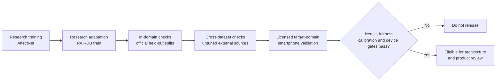

# Dataset Strategy Recommendation

**Milestone:** 1.1 Dataset Validation  
**Last reviewed:** 2026-08-04  
**Decision status:** Research recommendation; production rights and target-domain validation remain unresolved  
**Related:** [Dataset Comparison](DATASET_COMPARISON.md) · [Dataset Governance](DATASET_GOVERNANCE.md) · [Dataset References](DATASET_REFERENCES.md) · [Research Gaps](RESEARCH_GAPS.md)

## 1. Executive decision

### Facts

No required public dataset simultaneously provides:

1. clear rights for a production mobile model,
2. strong in-the-wild annotation quality,
3. representative smartphone-front-camera coverage, and
4. adequate demographic evidence for fairness claims.

AffectNet offers the best scale among the required datasets, while RAF-DB offers the strongest dense categorical vote evidence. Both standard access agreements restrict use to non-commercial research [D06]–[D10]. FER+ improves label uncertainty but inherits unresolved FER2013 image rights [D02]–[D05]. Cross-dataset performance degradation and demographic gaps are established concerns [D18]–[D20].

### Recommendation

Use a **license-gated, multi-dataset research strategy**:

- **Primary research training:** AffectNet’s common seven-class subset, under its academic agreement.
- **Research fine-tuning / secondary source:** RAF-DB basic-expression training split, kept source-aware rather than blindly concatenated.
- **Ambiguity and low-resolution auxiliary work:** FER+ vote distributions, only after FER2013 image rights are documented.
- **In-domain validation:** untouched official AffectNet validation and RAF-DB test splits.
- **Cross-dataset validation:** train/tune without the target dataset, then evaluate separately on RAF-DB and FER+ where rights permit.
- **Legacy/diagnostic benchmarks:** FER2013, CK+, JAFFE, and optionally SFEW; report each independently and with its protocol limitations.
- **ExpW:** exclude until an official source, exact version, and operative license are verified.
- **Release validation:** a new or licensed, consented, commercially usable, identity-disjoint smartphone corpus representing intended users and device conditions. None of the required public datasets can substitute for it.

This strategy supports technical discovery. It does **not** authorize distributing a model trained on non-commercial or unresolved data.

## 2. Weighted decision matrix

### Weighting rationale

The weights reflect project priorities—privacy, mobile performance, robustness, accuracy, and maintainability—and the special importance of lawful offline distribution.

| Criterion | Weight | Why it matters |
|---|---:|---|
| Licensing and commercial-use clarity | 20% | A production model is unusable if its training rights or downstream obligations are unresolved. |
| Diversity / representativeness | 15% | Robustness and fairness require variation in people and capture conditions. |
| Annotation quality | 15% | Reliable labels, multiple raters, and quality control limit avoidable supervision error. |
| Mobile realism | 15% | Front-camera conditions, small faces, pose, lighting, and occlusion affect deployment validity. |
| Dataset size | 10% | Lightweight models still need sufficient coverage and rare-class examples. |
| Label utility / uncertainty | 10% | Vote distributions, invalid-face labels, and continuous targets enable ambiguity and confidence research. |
| Maintainability / official availability | 7% | Durable official access, versioning, and documentation support reproducibility. |
| Community adoption | 8% | Established benchmarks improve comparability and reveal protocol errors. |

Scores range from 1 (poor) to 5 (strong). The weighted total is `sum(weight × score / 5)`, out of 100. Detailed evidence is in [DATASET_COMPARISON.md](DATASET_COMPARISON.md).

| Dataset | License 20 | Diversity 15 | Annotation 15 | Mobile 15 | Size 10 | Label utility 10 | Maintain. 7 | Adoption 8 | Weighted /100 |
|---|---:|---:|---:|---:|---:|---:|---:|---:|---:|
| RAF-DB | 2 | 4 | 5 | 4 | 3 | 5 | 4 | 5 | **76.6** |
| AffectNet | 2 | 4 | 3 | 4 | 5 | 5 | 4 | 5 | **74.6** |
| FER+ | 2 | 2 | 4 | 3 | 3 | 5 | 3 | 5 | **63.2** |
| ExpW | 1 | 4 | 3 | 4 | 5 | 3 | 1 | 3 | **59.2** |
| CK+ | 1 | 2 | 5 | 1 | 1 | 4 | 2 | 5 | **48.8** |
| JAFFE | 2 | 1 | 4 | 1 | 1 | 4 | 4 | 4 | **48.0** |
| FER2013 | 1 | 2 | 2 | 3 | 3 | 2 | 3 | 5 | **47.2** |

### How to interpret the matrix

The total ranks **research usefulness**, not permission to ship. RAF-DB and AffectNet score well scientifically but fail the production license gate under their standard terms. ExpW’s size cannot compensate for unknown rights and provenance. Controlled datasets receive useful annotation scores but low mobile-realism scores.

**Hard gate:** a dataset with non-commercial, missing, conflicting, or unverified terms cannot enter the lineage of a distributed production model until written clearance is recorded. The gate overrides every numerical score.

### Assumptions

- EmotionSense AI could ultimately be distributed commercially; governance must therefore use the stricter interpretation now.
- All criteria use the same 1–5 ordinal scale; small score differences are not statistically meaningful.
- A license score of 2 recognizes clear academic terms, not commercial suitability.

### Trade-offs

- Weighting licensing highly prevents wasted production work but can rank scientifically valuable academic datasets below their research merit.
- Community adoption helps comparison but may reward legacy datasets whose protocol is no longer deployment-realistic.
- A single total is easy to communicate but hides non-compensable blockers; the hard gate corrects this.

### Open questions

- Will EmotionSense AI be commercial, research-only, open-source, or offered under multiple terms?
- Can commercial rights be negotiated for AffectNet or RAF-DB, and do those rights explicitly cover distributed on-device weights?
- Should consent provenance become a separately scored criterion once candidate commercial corpora are found?

## 3. Candidate strategies

### Strategy A — single-dataset training

Use AffectNet alone because it is the largest and most varied required dataset.

**Advantages**

- Simplest ontology, preprocessing lineage, sampling policy, and reproducibility story.
- Large scale and broad nuisance variation support research on lightweight classifiers [D08].
- Official validation protocol improves comparability.

**Disadvantages**

- Search-engine and annotation biases become the product’s dominant biases.
- Mainly single-annotator labels and substantial inter-annotator disagreement limit label certainty.
- Academic license blocks production use under standard terms.
- In-domain validation can conceal dataset-specific shortcuts [D19].

**Conclusion:** insufficient for production and weaker than a controlled multi-source research comparison.

### Strategy B — naïve multi-dataset concatenation

Merge all images with the same seven class names and train one corpus.

**Advantages**

- Maximum nominal sample count and nuisance diversity.
- Potential exposure to multiple resolutions and annotation styles.

**Disadvantages**

- The same class name represents posed apex movement, search-query meaning, crowd perception, or expert judgment depending on source.
- Class priors, preprocessing, duplicate risk, and source quality differ; a model can learn dataset identity rather than expression.
- License obligations and deletion rights become entangled in the resulting weights.
- Dataset-specific validation leakage is harder to diagnose.

**Conclusion:** not recommended.

### Strategy C — source-aware pretraining and fine-tuning

Train first on the largest cleared research source, then adapt with a higher-vote in-the-wild source while preserving source IDs, original label distributions, and separate evaluation.

**Advantages**

- Uses AffectNet scale and RAF-DB annotation density without pretending they are identical.
- Enables ablations: AffectNet only, RAF-DB only, and staged adaptation.
- Keeps dataset-specific error, calibration, and fairness evidence visible.
- Supports FER+ as a separate uncertainty/low-resolution experiment rather than contaminating the core corpus.

**Disadvantages**

- More experiment governance, ontology mapping, sampling, and reproducibility work.
- Fine-tuning can forget source diversity or overfit RAF-DB’s smaller split.
- Both principal sources remain non-commercial under standard terms.

**Conclusion:** recommended for Milestone research, subject to access agreements.

### Strategy D — benchmark-only public datasets plus a licensed target corpus

Train and validate production candidates on consented/licensed smartphone data; use public academic datasets only when their terms allow benchmark evaluation.

**Advantages**

- Best alignment with privacy, consent, target devices, geography, and commercial distribution.
- Enables deliberate subject-disjoint splits, demographic sampling, expression ambiguity labels, and quality metadata.
- Reduces long-term dependence on disappearing academic links and unclear web-image rights.

**Disadvantages**

- Highest acquisition, annotation, legal, and maintenance cost.
- A consented corpus may initially be smaller and less diverse than AffectNet.
- Requires careful collection design to avoid coercion, privacy leakage, and artificial expressions.

**Conclusion:** required destination for production, combined with Strategy C for non-commercial discovery.

## 4. Final role assignment

| Lifecycle role | Dataset(s) | Decision and justification |
|---|---|---|
| Primary research training | AffectNet | Largest required in-the-wild corpus; broad conditions and categorical plus valence/arousal labels. Use only within academic terms. |
| Research fine-tuning | RAF-DB basic training split | Approximately 40 votes/image and strong unconstrained annotations complement AffectNet. Non-commercial only. |
| Auxiliary uncertainty work | FER+ | Ten-vote distributions, unknown and not-a-face labels are useful for ambiguity/confidence research. FER2013 image rights must first be cleared. |
| In-domain validation | AffectNet official validation; RAF-DB official test | Keep untouched and report separately. These measure source-domain generalization, not release readiness. |
| Cross-dataset validation | RAF-DB when trained without RAF-DB; FER+ when trained without FER/FER+ | Reveals domain shift. Do not tune thresholds on the cross-dataset holdout. |
| Legacy benchmarking | FER2013; FER+ | Enables literature comparison, with explicit noise, rights, and low-resolution caveats. |
| Controlled diagnostic benchmark | CK+; JAFFE | Tests prototypical posed expressions and protocol discipline; never pool with in-the-wild metrics. |
| Optional tough-condition benchmark | SFEW | Movie-frame domain-shift stress test if official terms permit. |
| Excluded pending evidence | ExpW | No verified durable official access/license/version route in this review. |
| Production training/fine-tuning | New or procured consented, commercially licensed smartphone corpus | Must represent target users/devices and grant on-device model distribution rights. |
| Release validation | Locked target-domain smartphone holdout | Identity-disjoint, never used for training, model selection, calibration fitting, or threshold tuning. |

### Validation hierarchy

Passing a left-hand stage does not imply passing a later stage.

## 5. Ontology and evaluation rules

### Facts

The seven shared names—anger, disgust, fear, happiness, sadness, surprise, neutral—mask methodological differences [D18], [D21]. AffectNet and FER+ also expose contempt and uncertainty-related labels; CK+ has contempt peaks but no independently elicited neutral peak.

### Assumptions

- Initial cross-dataset comparison uses seven common expression-estimate outputs.
- Original labels, vote counts, valence/arousal, and invalid/uncertain markers remain immutable in the data manifest.
- Contempt is not silently mapped to neutral or disgust. It is excluded from seven-class metrics or reported as an additional source-specific class.
- Labels describe perceived facial display, not a person’s internal state.

### Trade-offs

- A seven-class intersection improves comparison but loses compound, contempt, intensity, and continuous-affect information.
- Soft distributions preserve disagreement but complicate comparison with hard-label published baselines.
- Source-aware evaluation adds reporting overhead but exposes domain shortcuts and label conflicts.

### Evaluation minimums

- Report macro F1 and unweighted average recall, not accuracy alone.
- Report per-class precision/recall and confusion matrices because class imbalance is large.
- Report calibration and selective-prediction behavior: expected calibration error, Brier or log loss where label form permits, coverage, and error among non-abstained predictions.
- Use subject-disjoint partitions whenever identity metadata makes this possible.
- Measure performance separately by dataset and by approved quality/demographic slices; include uncertainty intervals and sample counts.
- Do not compare CK+/JAFFE posed-apex numbers directly with AffectNet/RAF-DB in-the-wild numbers.

## 6. Risks and controls

| Risk | Consequence | Control / release gate |
|---|---|---|
| Non-commercial or unknown license | Injunction, takedown, inability to distribute weights | Written legal approval for every ancestor dataset; model lineage inherits the strictest unresolved term. |
| Dataset bias | Unequal or brittle predictions | Per-source and intersectional evaluation; target-domain collection; failure-state UX. |
| Domain shift | Strong benchmark result but poor front-camera performance | Locked multi-device smartphone holdout and cross-dataset tests. |
| Label inconsistency | Conflicting supervision and misleading scores | Versioned ontology mapping; retain original distributions; source-aware experiments. |
| Identity/duplicate leakage | Inflated validation metrics | Identity-disjoint splits where possible; later duplicate audit under allowed terms. |
| Class imbalance | Majority-class accuracy hides rare failures | Source-aware sampling experiments; macro metrics and per-class reporting. |
| Expression ambiguity | Confident but unjustified output | Preserve vote distributions; confidence calibration; abstention/unavailable state. |
| Demographic metadata weakness | Unsupported fairness claims | Do not infer sensitive attributes; collect consented self-described metadata for target validation. |
| Upstream disappearance/version drift | Irreproducible evidence | Versioned manifest, agreement copy, checksums, official source snapshot metadata; no unauthorized redistribution. |
| License revocation or retention obligation | Model ancestry becomes noncompliant | Dataset/model dependency graph, deletion procedure, and retraining capability. |

## 7. Open questions

1. What distribution and business model will determine the required commercial rights?
2. Do negotiated AffectNet or RAF-DB terms permit commercial training, derived weights, offline embedding, sublicensing through app stores, and model updates?
3. What countries, age range, device tiers, skin-tone ranges, assistive needs, lighting, pose, and occlusion conditions define the intended-use population?
4. Can a consented East African smartphone corpus be collected ethically and at sufficient scale, or should it be licensed from a qualified provider?
5. What minimum per-slice sample sizes, uncertainty intervals, calibration targets, and disparity thresholds constitute a release gate?
6. How will multiple plausible expressions and low annotator agreement be represented in product evaluation?
7. Can cross-source duplicate or identity leakage be audited within each agreement?
8. Will the initial ontology include contempt, compound expressions, valence/arousal, or only seven basic expression estimates?
9. Which model-use restrictions survive dataset deletion or agreement termination?

## 8. Proposed decision record

The recommendation should become an ADR only after rights and intended-use scope are resolved. Until then, record this as a research conclusion: **public academic FER datasets are evidence sources, not presumed production assets**.

