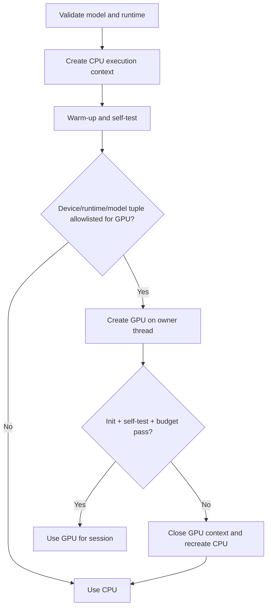

# Mobile Device Compatibility Strategy

**Milestone:** 1.3 Mobile Architecture Validation  
**Status:** Proposed support policy; physical-device matrix not yet approved  
**Last reviewed:** 2026-08-04  
**References:** [Mobile References](MOBILE_REFERENCES.md)

## 1. Support principle

A device is supported only when the complete production artifact—camera, detector, preprocessing, classifier, confidence policy, lifecycle, and CPU fallback—passes the minimum budgets. OS version or accelerator presence alone does not establish support. Average performance on newer devices cannot compensate for a failing baseline tier.

## 2. Proposed minimum supported Android profile

| Characteristic | Proposed minimum | Status and rationale |
|---|---|---|
| OS | Android 7.0, API 24 | **Project assumption.** Aligns with the current official Flutter camera package support floor [FL03]; re-evaluate with MediaPipe/LiteRT release artifacts before implementation |
| CPU ABI | 64-bit ARM (`arm64-v8a`) | **Project assumption.** One primary production ABI reduces native matrix complexity; 32-bit-only devices are excluded unless an access review justifies separate validation |
| CPU | 4 application cores with ARM NEON-capable 64-bit execution | **Project assumption.** Exact microarchitecture is not a support proxy; physical benchmarks decide |
| RAM | 3 GB physical RAM, with app meeting ≤64 MB incremental pipeline peak | **Project assumption.** Total RAM does not guarantee available memory; low-memory lifecycle tests remain mandatory |
| Camera | User-facing camera; lifecycle-safe preview plus CPU-accessible streaming analysis frames; delivered analysis size at least 480p-class | **Required capability.** Nominal megapixels do not substitute for usable exposure/focus/face pixels |
| Storage | Space for app, bundled detector and one classifier with validation manifest | **Assumption.** No runtime model download is required |
| Services | No Google Play Services requirement | **Recommendation.** Use packaged standalone runtimes so core offline support includes non-GMS Android distributions |
| Accelerator | None required | CPU compatibility is the universal baseline |

The Flutter `camera` package's endorsed Android implementation is based on CameraX and is documented as supporting API 24+ at the reviewed version [FL03]. This does not prove that the eventual native MediaPipe/LiteRT combination has the same floor; dependency manifests and physical devices must confirm it.

## 3. Device tiers and expected experience

| Tier | Characteristics | Expected analysis experience |
|---|---|---|
| Minimum supported | Meets profile above; CPU only; limited thermal headroom | Smooth preview, 5 fresh estimates/s target, 480p-class analysis, CPU inference, may reduce cadence under sustained load; all minimum budgets pass |
| Recommended | API 29+; 4 GB+ RAM; materially faster 64-bit CPU; stable front camera; validated thermal callbacks | 8–10 estimates/s, aspirational latency/RAM targets, CPU default; optional allowlisted GPU after benchmark |
| High-performance | Recent 64-bit SoC; 6 GB+ RAM; strong sustained CPU/GPU; high-quality front camera | Stable 10 estimates/s with headroom; optional validated GPU; **same model, preprocessing, thresholds, and semantics** as other tiers |

Tiers control cadence/resolution/delegate policy, not the semantic model or confidence threshold. A faster device does not receive a different emotion model in Version 1.

## 4. Delegate selection policy

### CPU default

CPU is required, tested first, and remains the recovery path. Evaluate current LiteRT `CompiledModel` first and retain `Interpreter` as a reference/compatibility candidate [LR01]. Select a validated thread count by tier where applicable. If CPU cannot meet the minimum experience, the device is unsupported; acceleration must not disguise the absence of a reliable fallback.

### GPU delegate

GPU is opt-in by a versioned allowlist keyed by relevant device/OS/runtime/model tuple, not enabled merely because a compatibility query returns true. Promotion requires sustained latency/energy benefit, RAM compliance, output/calibration parity, lifecycle reliability, and successful forced-failure fallback. LiteRT warns that delegate performance varies by device/model and that GPU has thread affinity [LR02][LR03].

### NNAPI

Do not select NNAPI for new production deployments. It is available from API 27 but deprecated in API 35, and Android recommends migration to alternatives such as LiteRT GPU [AN01]. Retain NNAPI only as a benchmark comparison if useful to explain legacy-device results.

### Fallback behavior

- Delegate/accelerator initialization failure: close partial resources and create a fresh CPU execution context before accepting frames.
- Delegate invocation error: stop frame admission, invalidate current results, tear down the delegate on its owner thread, recreate CPU, warm up, and resume once.
- Repeated CPU/runtime failure: end analysis as `inferenceUnavailable`; never loop indefinitely.
- Fallback is session-visible in local diagnostics but must not expose hardware identifiers in user messaging.

## 5. Unsupported or degraded hardware

Mark unsupported before capture when the OS/ABI/runtime contract cannot load. Mark temporarily unavailable when camera permission, camera access, memory, or thermal conditions prevent a safe session. A device that supplies preview but cannot meet minimum end-to-end freshness, reliability, or quality gates is unsupported for analysis, even if the model technically runs.

Capability detection must cover:

- front-camera enumeration and analysis-stream support;
- actual delivered resolution/pixel format/rotation behavior;
- model tensor/operator compatibility and asset integrity;
- memory pressure during simultaneous preview, detection, and classification;
- CPU sustained budgets;
- optional delegate creation and partitioning.

## 6. Future iOS compatibility

Preserve a platform-neutral `VisionSessionPort`, model/preprocessing manifest, result schema, and CPU reference outputs. The iOS adapter would use AVFoundation for capture and the same LiteRT artifact where compatible. LiteRT's Core ML delegate can accelerate float32/float16 models on newer Apple hardware; official guidance associates Neural Engine availability with A12-class and newer hardware [LR05].

Do not design an iOS-specific implementation in this milestone. The current INT8-first CPU candidate and Core ML's documented model-type constraints may lead to different acceleration behavior, so iOS CPU, GPU, and Core ML paths need independent correctness/calibration and sustained-performance validation. No delegate is presumed equivalent.

## 7. Compatibility test matrix

At minimum include:

1. oldest supported API/low-performance 64-bit device;
2. API 29 recommended-tier device without relying on acceleration;
3. recent mid-tier device with a validated GPU candidate;
4. recent high-performance device;
5. one non-GMS Android distribution if standalone runtime support is claimed;
6. devices from multiple SoC/GPU vendors;
7. future oldest-supported and recent iPhones when iOS validation begins.

Each row runs CPU first, then optional delegates, with cold/warm latency, output parity, 10-minute sustained load, paired battery test, rotation/background/resume, permission revocation, low memory, delegate failure, and low-light/motion capture cases.

## 8. Facts, assumptions, trade-offs, and open questions

### Facts

- LiteRT delegates can accelerate supported graph portions but must be benchmarked on the actual model/device [LR02].
- NNAPI is deprecated in Android 15 [AN01].
- Core ML delegate support differs by model numeric format and Apple hardware [LR05].

### Assumptions

- API 24, arm64, and 3 GB RAM provide a defensible initial reach/maintenance boundary.
- Standalone bundled runtimes best serve offline/non-GMS compatibility and deterministic versioning.
- One semantic model across tiers is maintainable and reduces fairness/calibration divergence.

### Trade-offs

- A newer OS floor lowers test burden and increases platform capabilities but excludes users.
- Bundled runtimes increase package size but avoid runtime-service availability as a core dependency.
- GPU allowlisting sacrifices automatic coverage for reliability and reproducibility.

### Open questions

1. What user population and market data justify the final API/ABI/RAM floor?
2. Does the final MediaPipe Tasks release support API 24 with the required packaged binaries?
3. Which GPU/device tuples produce sustained benefit for the final quantized model?
4. Can a non-GMS test row pass the full packaged-runtime flow?
5. What will the future iOS minimum OS/device policy be?
