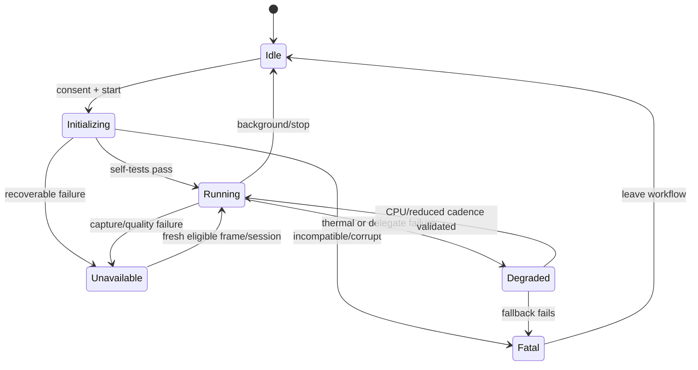

# Mobile Inference Failure Modes

**Milestone:** 1.3 Mobile Architecture Validation  
**Status:** Proposed failure policy  
**Last reviewed:** 2026-08-04  
**References:** [Mobile References](MOBILE_REFERENCES.md)

## 1. Failure principles

Expected capture and inference problems are typed outcomes, not exceptions or forced classifications. The pipeline fails closed: stop capture when authority is absent, abstain when evidence is inadequate, discard stale results, and fall back only to a path already validated for the same model contract.

User messages describe what can be done, not internal implementation details. “No reliable expression estimate” is preferable to implying that the user has no emotion or that the model knows an internal state.

## 2. Failure catalogue

| Scenario | Likely cause | Detection | User-facing behavior | Recovery |
|---|---|---|---|---|
| Camera unavailable | No front camera, camera in use, hardware/service error | Enumeration/bind/open error or interruption callback | “Camera isn’t available right now.” Analysis stopped | Retry on explicit user action or availability callback; re-enumerate; never spin |
| Permission denied | User denies request | Permission result | Explain camera is required; offer continue without analysis/settings guidance | Recheck only after user action |
| Permission permanently denied/restricted | OS policy, parental/enterprise restriction, “don’t ask again” | Platform permission status | Explain limitation without blame; no repeated prompt | Deep-link to settings only on user request; recheck on resume |
| Permission revoked mid-session | Settings/privacy control changes | Lifecycle/permission check or camera error | Immediately clear estimate and stop preview/analysis | Release camera/runtime; require fresh authorization |
| No face detected | User absent, detector miss, extreme pose/occlusion | Empty detector result over a short debounce window | Neutral framing guidance; output unavailable | Continue low-cost detection while foreground; do not classify |
| Multiple faces | More than one plausible face | Detector returns ≥2 eligible/ambiguous detections | “Only one person should be in frame.” No label | Continue detection; resume only when exactly one face is stable |
| Face too small | Distance or analysis resolution too low | Face/inter-eye pixel threshold | Ask user to move closer | Continue detection; do not upscale and classify |
| Face outside frame | Crop margin crosses bounds or key features missing | Box/keypoints against source bounds | Directional framing guidance | Resume after complete crop is stable |
| Motion blur | Movement, long exposure, camera shake | Validated blur metric below threshold | Ask user to hold steady or improve light | Retry future frames; never reuse stale accepted score |
| Low light/overexposure | Poor illumination/backlight | Validated luma/contrast/clipping gate | Suggest even front lighting | Retry future frames at reduced cadence if needed |
| Excess pose/occlusion | Head angle, hand/mask/hair obstruction | Keypoint geometry or validated landmarker quality signal | Ask for a clearer, near-frontal view | Return unavailable until quality recovers |
| Crop/preprocessing contract mismatch | Rotation, mirroring, channel/range or model metadata defect | Startup manifest validation and golden-tensor test; runtime shape/type checks | “Analysis is unavailable.” | End session; no automatic alternate preprocessing |
| Model asset missing/corrupt | Packaging error, storage corruption | Hash/signature/open failure | Analysis unavailable; camera need not start | One clean reload; then require app update/reinstall guidance |
| Model schema/version mismatch | Incompatible labels, tensor, calibration or preprocessing | Manifest compatibility check | Analysis unavailable | Reject artifact atomically; never guess labels |
| Delegate initialization failure | Unsupported driver/op, allocation or thread issue | Delegate creation/self-test error | Usually seamless brief initialization delay; no hardware detail | Tear down and create validated CPU interpreter; record local counter |
| Delegate invocation failure | Driver reset, unsupported dynamic behavior, lifecycle/thread violation | Runtime error/timeout or invalid output | Clear current estimate; brief “restarting analysis” | Invalidate session; close delegate on owner thread; warm CPU fallback once |
| CPU inference failure | Runtime/model bug or memory pressure | Runtime error, invalid/non-finite output | Analysis unavailable | Recreate once after releasing resources; otherwise end session |
| Thermal throttling | Sustained camera/ML load, hot ambient, charging | API 29+ thermal status and sustained latency/busy-rate trend [AN02] | Reduce update rate; severe state pauses analysis with cooling guidance | Hysteretic cadence/resolution reduction; resume after stable recovery |
| Low memory | OS trim/kill pressure, delegate buffers, repeated allocation | Platform memory callback, allocation failure, measured RAM limit | Analysis pauses/restarts; UI remains usable | Stop admission; release camera/runtime/pools; explicit fresh initialization |
| Unsupported device | OS/ABI/camera/runtime or sustained budget failure | Preflight and support matrix | Explain that on-device analysis is not supported | No cloud fallback; allow non-analysis parts of app |
| Stale/out-of-order result | Slow callback, rotation/background, old session | Timestamp, monotonic sequence, session generation | Result is ignored; UI remains unavailable/current | No retry; next valid current-session result wins |
| Camera image leak/backpressure stall | Image not closed on every path | Watchdog sees no frames; resource counters/profiling | Attempt session restart; no stale label | Close in guaranteed path; recreate camera once; treat repeats as fatal session bug |
| Platform-channel disconnect | Engine/activity recreation or adapter crash | Channel error/generation mismatch | “Analysis was interrupted.” | Cancel session; rebind only after lifecycle stable |
| UI rendering lag | Excess state events/main-isolate work | Flutter frame timing misses | Preview/result rate may reduce; no semantic change | Coalesce updates; lower cadence; investigate boundary violation |

## 3. State and retry policy

Retry rules:

- quality failures are naturally retried by future admitted detector frames;
- resource creation may retry once after complete teardown;
- delegate failure may fall back once to CPU;
- permission and permanent compatibility failures never auto-retry;
- every restart increments a session generation so late callbacks are harmless;
- exponential retry loops are forbidden in the foreground camera pipeline.

## 4. Multiple-face policy

Version 1 is single-user. If detections overlap, fluctuate, or a second plausible face enters, clear temporal state and abstain. Do not select based on face size, screen center, identity, or persistence because that can analyze a bystander without clear intent. Resume only after exactly one eligible face remains stable for a validated interval.

## 5. Diagnostic policy

Permitted local diagnostics are coarse reason code, stage duration, delegate type, dropped-frame count, thermal band, model/runtime version, and session-scoped correlation ID. Never log images, crops, landmarks, logits, labels tied to a person, stable device identifiers, or permission history. Any remote telemetry requires the separate privacy/ethics review.

## 6. Facts, assumptions, trade-offs, and open questions

### Facts

- CameraX requires every analysis image to be closed; otherwise preview may stall or frames may drop [AX01].
- MediaPipe live-stream calls can drop/ignore input while busy, so missing one result is not necessarily a fatal error [MP01].
- The Flutter camera plugin requires application-owned lifecycle and permission-error handling [FL03].

### Assumptions

- One teardown/recreate attempt is sufficient to distinguish transient from persistent runtime failure.
- Blur/light/face-size/pose thresholds can be validated with adequate target data.
- Severe thermal pressure should pause analysis rather than silently producing very stale estimates.

### Trade-offs

- Debouncing avoids flashing guidance but delays detection of a genuine failure.
- Automatic CPU fallback preserves availability but temporarily increases initialization latency and may change performance.
- Conservative multi-face abstention reduces coverage but protects privacy and attribution reliability.

### Open questions

1. What debounce/recovery intervals avoid flicker without retaining stale claims?
2. Which quality metrics correlate with FER error across approved demographic/environment slices?
3. What watchdog can distinguish camera starvation from intentionally low cadence?
4. Which failures may be reported remotely after the privacy review, and at what granularity?
5. What accessibility wording and non-camera alternative are required for every terminal state?

