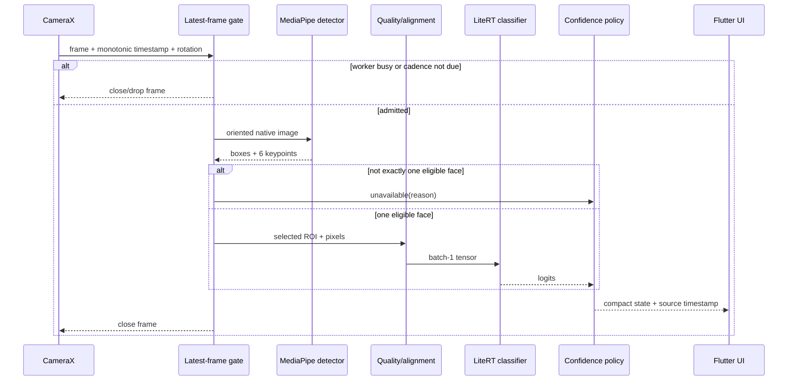

# Mobile Inference Pipeline

**Milestone:** 1.3 Mobile Architecture Validation  
**Status:** Proposed, pending model and physical-device validation  
**Last reviewed:** 2026-08-04  
**Related:** [Mobile Architecture](MOBILE_ARCHITECTURE.md) · [Performance Targets](PERFORMANCE_TARGETS.md) · [References](MOBILE_REFERENCES.md)

## 1. End-to-end contract

The pipeline converts a transient camera frame into either a calibrated, time-bounded expression estimate or an explicit unavailable outcome. It never guarantees knowledge of internal emotion, never forces a class, and never stores the frame.

## 2. Stage-by-stage design

### 2.1 Frame acquisition

Acquire the front-camera preview and an analysis stream through one lifecycle-bound camera session. Prefer `YUV_420_888` for analysis because it is CameraX's default CPU-accessible format; request only a resolution the pipeline needs. Preserve sensor-to-display rotation and mirroring as metadata rather than destructively rotating the preview [AX01].

**Trade-off:** CameraX can supply RGBA but performs an internal YUV-to-RGBA conversion. YUV reduces early bandwidth; RGBA can simplify integration. Measure end-to-end rather than assuming either is faster.

### 2.2 Frame selection and skipping

Use two gates:

1. a target cadence gate, initially 10 Hz on recommended hardware and 5 Hz on minimum-tier hardware; and
2. a single-flight busy gate with capacity one and no pending backlog.

When busy, drop the incoming analysis frame immediately. Use the source timestamp for freshness and smoothing. CameraX's keep-only-latest policy and MediaPipe live-stream busy behavior both support a low-latency, frame-dropping design [AX01][MP01]. Do not depend on two independent queues; the session scheduler remains the policy owner.

### 2.3 Face detection

Run MediaPipe Face Detector in live-stream mode. Retain all detections long enough to enforce the multi-face policy. The detector supplies a box, detection score, and six keypoints [MP01].

Eligibility requires exactly one selected face, adequate face pixel size, safe crop margin, acceptable roll/pose proxy, and stability over a short observation. If two plausible faces are present, return `multipleFaces`; do not choose the largest silently. Detector score is a location-quality signal, not emotion confidence.

**Alternative:** Face Landmarker supplies dense landmarks, transformation matrices, and optional blendshapes [MP02]. It should replace—not follow—the default detector/alignment path in a controlled experiment. EmotionSense must not substitute MediaPipe blendshapes for the approved emotion classifier.

### 2.4 Region extraction and alignment

Expand the detected face box by a versioned margin so forehead, jaw, and cheek evidence are retained. Estimate in-plane roll from eye keypoints and apply a similarity transform into a canonical crop. Clamp against image bounds; reject rather than pad excessively when required pixels lie outside the frame.

Three preprocessing candidates must be tested using identical identity-disjoint samples:

- padded detector box only;
- six-keypoint roll alignment (recommended starting point);
- dense-landmark alignment using Face Landmarker.

The chosen transform becomes part of the model contract and must match training/evaluation exactly. Alignment is a project recommendation, not yet a measured fact.

### 2.5 Quality gates

Before classification, compute inexpensive, documented checks for:

- face pixel size and crop completeness;
- exposure/contrast (low light or clipping);
- blur using a validated proxy;
- excessive roll/pose or keypoint inconsistency;
- occlusion only where the chosen detector/landmarker supplies a validated signal.

Thresholds must come from target-domain selective-risk experiments. A heuristic threshold is never relabeled as model confidence. Quality failures produce guidance and do not enter temporal smoothing.

### 2.6 Image preprocessing

Convert only the selected ROI to RGB, resize once to the locked classifier size (candidate 160, 192, or 224 square), and apply the exact channel order, numeric range, quantization scale/zero point, and interpolation method declared in the signed model manifest. Reuse input storage.

LiteRT Task Library `ImageClassifier` can own ROI, rotation, resizing, color conversion, labels, top-k, and a score threshold when the model carries mandatory compatible metadata [LR04]. For EmotionSense, prefer a lower-level LiteRT API because alignment, quality gates, calibration, and abstention are safety-relevant and must remain explicit. The current `CompiledModel` API is the preferred spike candidate; `Interpreter` remains the compatibility/reference candidate [LR01]. Reconsider Task Library only if golden-tensor parity proves its preprocessing contract is exact.

### 2.7 Model inference

Invoke one batch-1 MobileNetV3-Small execution context at a time. The output contract is logits in fixed class order, not display strings. Validate model hash, tensor shapes/types, label schema, preprocessing version, and calibration version before the session becomes ready. EfficientNet-Lite0 is a separately validated fallback architecture, not a runtime-selected second model.

### 2.8 Calibration and abstention

Apply temperature scaling or a better validated method learned on an identity-disjoint calibration split after the final quantization and delegate path are fixed. Modern neural networks can be miscalibrated; temperature scaling is a simple established baseline [ML01]. Then apply class-specific acceptance thresholds, quality eligibility, OOD policy (if validated), and freshness.

Return one of:

- `accepted(label, calibratedScore, timestamp, modelVersion)`;
- `unavailable(reason, timestamp)`; or
- `fatal(sessionFailure)`.

Never expose a raw softmax score as certainty. Calibration and coverage must be evaluated by class and approved slices, as required by [Performance Targets](PERFORMANCE_TARGETS.md).

### 2.9 Temporal smoothing

Start with a timestamp-aware exponential moving average over calibrated class distributions, with a short tunable half-life. Publish only after a small number of temporally consistent eligible samples. Reset immediately on face loss, multiple faces, long gaps, lifecycle transition, rotation, camera change, model/delegate change, or session generation change.

Do not carry forward an accepted result beyond a strict freshness window. A stale UI shows unavailable, not the last confident label. Compare EMA against majority vote and no smoothing for transition delay, flicker, selective risk, and subgroup coverage. Temporal smoothing is an **assumption pending validation**.

### 2.10 UI update

Throttle semantic UI updates independently from analysis, coalescing identical state while preserving the newest timestamp. Flutter receives no images. Overlay coordinates use a tested sensor-to-preview transform. Accessibility announcements must be less frequent than visual updates and must not repeatedly announce unstable estimates.

## 3. Stage budgets

These are allocation assumptions within the existing p95 end-to-end aspiration of 180 ms, not measurements:

| Stage | Initial p95 allocation | Notes |
|---|---:|---|
| Admission and native handoff | 5 ms | Excludes time waiting for the next scheduled sample |
| Detection/tracking | 55 ms | Must be measured by tier |
| Quality, crop, conversion, resize | 35 ms | Includes alignment |
| Classifier | 40 ms | Matches classifier aspiration |
| Calibration/smoothing/result handoff | 10 ms | No raw buffers cross boundary |
| Contingency | 35 ms | Scheduling and device variance |

Allocations are not compensating averages: classifier p95 and total p95 gates still apply individually.

## 4. Facts, assumptions, trade-offs, and open questions

### Facts

- CameraX requires consumers to close each `ImageProxy`; failure can stall or drop frames [AX01].
- MediaPipe live-stream detection is asynchronous and ignores inputs submitted while busy [MP01].
- Task Library ImageClassifier requires compatible model metadata and batch-1 RGB input [LR04].

### Assumptions

- A 5–10 Hz estimate cadence is sufficient while preview remains display-rate smooth.
- Six-point alignment and a short EMA improve reliability enough to justify their work.
- A 640×480-class analysis stream will often be adequate; actual selected resolution is device- and face-size-dependent.

### Trade-offs

- Higher analysis resolution aids small faces but increases bandwidth, conversion cost, memory, heat, and battery.
- Strict quality and confidence thresholds improve accepted-result reliability but reduce coverage.
- Smoothing reduces flicker but delays genuine expression changes and can conceal uncertainty if freshness is weak.

### Open questions

1. What minimum inter-eye distance/face pixels preserve each class's recall?
2. Which crop margin, alignment strategy, interpolation, and model input size win on target data?
3. What calibration method and class thresholds meet selective-risk and fairness gates after quantization?
4. What smoothing half-life and freshness timeout balance stability and transition delay?
5. Is an independently validated OOD signal feasible inside the size/latency budgets?
