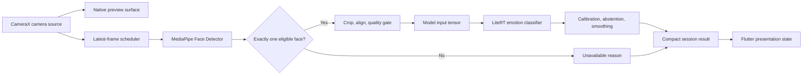
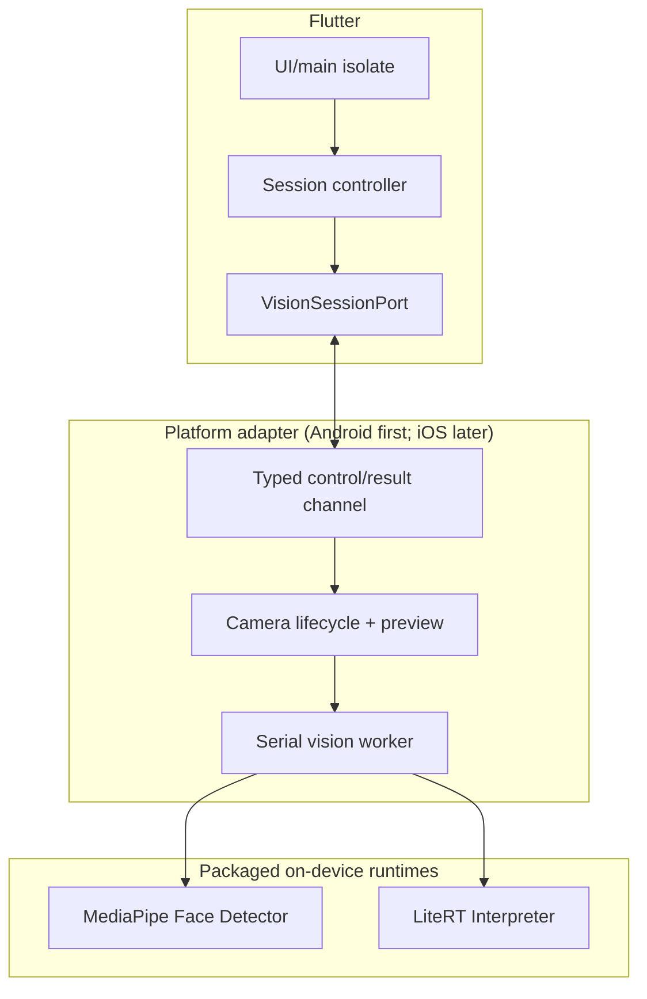

# Mobile Inference Architecture

**Milestone:** 1.3 Mobile Architecture Validation  
**Status:** Research recommendation; no implementation authorization  
**Last reviewed:** 2026-08-04  
**Related:** [Inference Pipeline](INFERENCE_PIPELINE.md) · [Performance Architecture](PERFORMANCE_ARCHITECTURE.md) · [Device Compatibility](DEVICE_COMPATIBILITY.md) · [References](MOBILE_REFERENCES.md)

## 1. Recommendation

Use a **native, session-scoped vision pipeline behind a Flutter domain port**. On Android, a CameraX-backed adapter should keep camera buffers, MediaPipe face detection, crop/alignment, and LiteRT inference inside one native boundary. Flutter receives only small immutable state updates. The camera preview remains independent of the 5–10 Hz analysis cadence.

Version 1 should use **MediaPipe Face Detector** for face location and its six keypoints for a conservative aligned crop, followed by the separately governed **MobileNetV3-Small 1.0 emotion classifier** through a LiteRT runtime adapter. The current LiteRT `CompiledModel` API is the preferred implementation-spike candidate; the mature `Interpreter` API remains the CPU/reference compatibility candidate until model, delegate, Flutter-boundary, and device tests select the production API [LR01]. Do not interpret MediaPipe keypoints or blendshapes as EmotionSense emotion classes. Dense Face Landmarker is a conditional replacement for the detection/alignment stage only if target-device tests demonstrate a material robustness gain within the budgets.

The trust boundary is explicit: raw frames are transient, never cross into domain entities, are not logged or persisted, and are released immediately after the native analysis callback.

## 2. Architectural boundaries

The platform interface exposes session commands such as initialize, start, pause, resume, stop, and dispose, plus typed results. It must not expose raw frames. A generated/type-safe channel contract is preferable to unstructured maps, but the exact binding tool is an implementation decision [FL02].

### Flutter camera integration approaches

| Approach | Benefits | Costs | Decision |
|---|---|---|---|
| Official Flutter `camera` plugin with Dart image stream | Maintained cross-platform API; endorsed Android CameraX implementation; fast prototype path [FL03] | Full frames enter Dart; additional native calls can copy/marshal them again; plugin lifecycle remains app-owned | Use for feasibility prototypes only unless profiling proves all budgets and no extra frame copy |
| Native session adapter with preview texture and native analysis | Buffers stay native; one backpressure owner; direct CameraX/MediaPipe/LiteRT lifecycle | More platform adapter code and an iOS counterpart | **Production recommendation** |
| Custom per-frame platform-channel calls | Simple concept | Serialization/copy pressure, stale-frame risk, fragile lifecycle | Reject |

## 3. Component responsibilities

| Component | Input | Output | Responsibility | Failure handling | Dependencies |
|---|---|---|---|---|---|
| Session controller | User/lifecycle intent | Presentation state and session commands | Consent/permission state machine; stale-result suppression | Maps typed failures to actionable UI; never retries forever | Domain policies, `VisionSessionPort` |
| Camera source | Permission, lens, target resolution | Timestamped native frame and preview | Front-camera acquisition, orientation metadata, preview | Close/rebind on interruption; surface camera unavailable | CameraX on Android |
| Latest-frame scheduler | Frames, busy/thermal state | At most one admitted frame | Enforce cadence and queue depth 1 | Drop, never queue, when busy | Monotonic clock, thermal policy |
| Face detector | Oriented frame | Boxes, confidence, six keypoints | Locate faces only; enable crop and coarse roll alignment | Empty/multiple/low-score output becomes unavailable | MediaPipe Face Detector |
| Optional landmarker | Frame or selected ROI | Dense landmarks/pose | Experiment-only enhanced alignment/pose quality | Fall back to detector architecture, not silently to altered geometry | MediaPipe Face Landmarker |
| Quality/alignment | Selected detection and pixels | Eligible normalized crop or reason | Face-size, bounds, blur/light/pose gates; versioned geometric transform | Abstain with capture guidance | Model input contract |
| Emotion classifier | Fixed batch-1 tensor | Logits | Classify the eligible crop; no detection responsibility | Recreate runtime once; then CPU fallback or unavailable | Packaged MobileNetV3-Small, LiteRT runtime adapter |
| Confidence policy | Logits and quality metadata | Accepted estimate or abstention | Temperature/class calibration, thresholds, freshness | Abstain; preserve reason category without sensitive details | Versioned calibration manifest |
| Temporal filter | Timestamped accepted estimates | Stable display estimate | Reduce single-frame flicker without inventing evidence | Reset on gaps, face loss, rotation, lifecycle, or model change | Monotonic timestamps |
| UI renderer | Compact typed state | Preview overlay/text | Render state and guidance only | Ignore out-of-session or out-of-order results | Flutter main isolate |

**Detection and classification remain separate:** the detector answers “where is an eligible face?”; the classifier answers “what is the model score distribution for this approved crop?” Detection confidence must never be used as emotion confidence.

## 4. Threading model

- **Flutter UI isolate:** widgets, preview state, permission prompts, and compact result rendering. No pixel conversion, detection, tensor construction, or model execution.
- **Native camera/executor threads:** CameraX produces preview and analysis images. `STRATEGY_KEEP_ONLY_LATEST` prevents analysis from stalling preview and requires deterministic `ImageProxy` closure [AX01].
- **Native serial vision worker:** owns detector, LiteRT execution/acceleration context, reusable buffers, and temporal state for a session. Serialization prevents concurrent model execution. If the Interpreter GPU delegate is selected, it must be created and invoked on the same thread [LR03].
- **Dart background isolate:** not required in the preferred design. Flutter isolates have separate memory and mutable messages are generally copied; a long-lived isolate is justified only for measured Dart-side work that exceeds the UI frame gap [FL01]. Unsolicited host callbacks also constrain plugin use from background isolates [FL01].

Model asset validation and runtime construction occur after the analysis screen is requested, off the UI thread. A warm-up inference precedes admission of live frames. Initialization returns an explicit ready/failure state; frames never race partially initialized resources.

## 5. Lifecycle state machine

| Event | Required behavior |
|---|---|
| App launch | Render UI without loading camera/ML; verify bundled manifest only when the analysis workflow is entered |
| Camera startup | Check consent and permission; select front camera; create native session; initialize detector/LiteRT context; warm up; then bind preview/analysis |
| Background/inactive | Stop frame admission immediately, invalidate session generation, unbind/close camera, release outstanding images; retain no pixels |
| Foreground resume | Recheck consent, permission, camera availability, model checksum, and thermal state; create/rebind a fresh session; do not replay old result |
| Rotation/configuration change | Update display rotation and coordinate transform; reset smoothing; avoid classifier work until crop/overlay transforms agree |
| Permission revoked/changed | Stop capture before presenting denied/restricted state; resume only after a fresh positive check |
| Low-memory callback | Stop analysis, release acceleration/execution context, detector, and pools; keep UI responsive; allow explicit reinitialization later |
| Camera interruption | Pause analysis and mark output unavailable; retry only when the platform reports availability or the user requests it |
| Screen exit | Cancel callbacks by generation token, unbind camera, close runtime and delegates in owner-thread order |

The Flutter camera plugin explicitly assigns lifecycle disposal/reinitialization to the app [FL03]. The same ownership rule applies to the native adapter.

## 6. Facts, assumptions, trade-offs, and open questions

### Facts

- CameraX supports a non-blocking keep-only-latest analysis strategy; a blocking analysis queue can also block preview [AX01].
- MediaPipe Face Detector returns bounding boxes and six facial keypoints and ignores a newly submitted live-stream frame when busy [MP01].
- Face Landmarker returns 478 landmarks and uses tracking in video/live-stream modes to reduce repeated detector work [MP02].
- Platform channels are asynchronous, but threading and serialization costs still require deliberate ownership [FL02].

### Assumptions

- Version 1 analyzes one consenting, near-frontal user for foreground sessions up to 15 minutes.
- Six detector keypoints can support the initial roll-aligned crop; this must be validated against unaligned and dense-landmark alternatives.
- The native-adapter maintenance cost is justified by avoiding raw-frame boundary crossings.

### Trade-offs

- Face Detector is lighter and simpler; Face Landmarker may improve pose/alignment gates but increases compute and uses a preview-stage API.
- A native pipeline improves buffer control but creates platform-specific adapters behind a shared domain contract.
- Lazy initialization improves launch time but delays the first analysis result; a progress state is required.

### Open questions

1. Does detector-keypoint alignment materially improve macro F1, calibration, and coverage on target smartphone data?
2. Does Face Landmarker add enough robustness to justify its latency, RAM, and preview API risk?
3. Can the official Flutter camera image stream meet the same zero-extra-copy and lifecycle requirements on the supported matrix?
4. What exact native/Flutter channel binding provides stable cancellation and typed errors?
5. Which raw diagnostic counters, if any, can be collected locally without increasing privacy risk?
