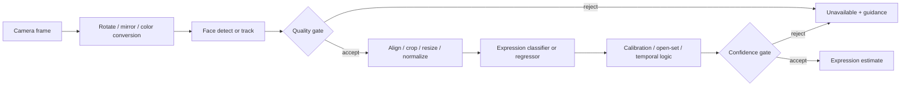
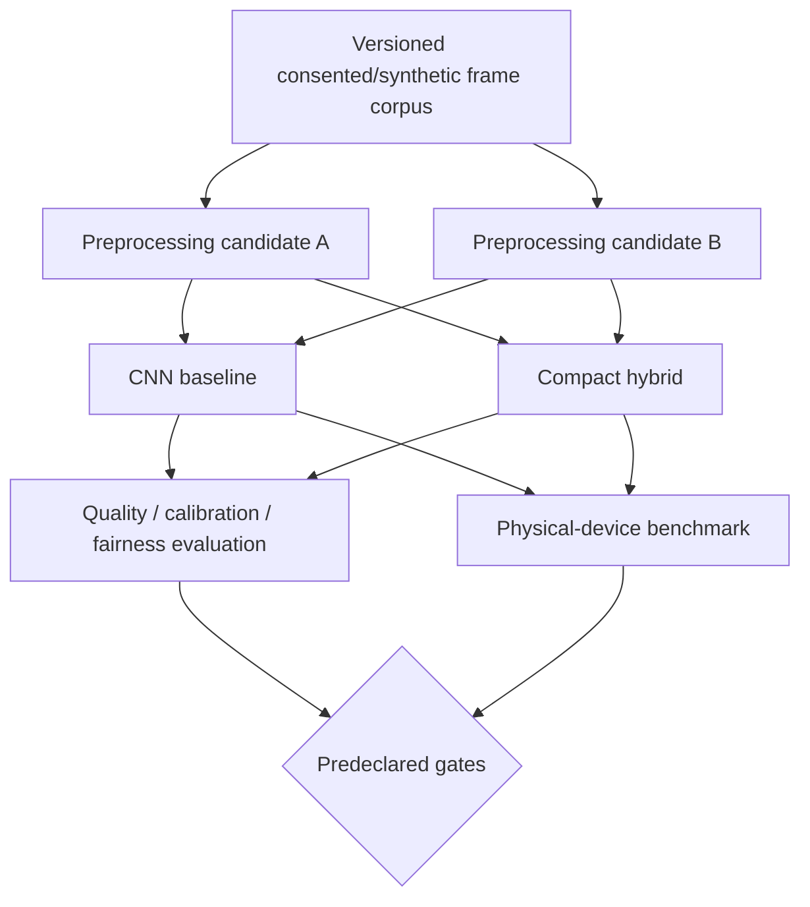

# Mobile Facial Expression Recognition Overview

## Document control

| Field | Value |
| --- | --- |
| Milestone | 1.0 — Technical Discovery & Validation |
| Research snapshot | 2026-08-04 |
| Scope | Common mobile pipelines, optimization choices, and expected measurement ranges |
| Decision status | Descriptive only; no architecture or model selected |

The project currently assumes MediaPipe for validated face preprocessing and TensorFlow Lite (now documented by Google under the LiteRT name) for approved on-device inference, behind data-layer adapters [P01][P02]. This document does not change that assumption. See [References](REFERENCES.md) and [Technical Limitations](TECHNICAL_LIMITATIONS.md).

## Typical on-device pipeline

For privacy-first operation, raw frames should be transient, the queue bounded, and only the minimum derived result retained according to user choice [P01][P02].

## Stage-by-stage responsibilities

| Stage | Common inputs/outputs | Failure modes | Mobile controls |
| --- | --- | --- | --- |
| Camera acquisition | YUV/BGRA pixel buffer, orientation, timestamp | dropped/stale frames, rotation, exposure, motion blur | resolution, frame rate, lifecycle, latest-frame policy |
| Conversion | RGB tensor or GPU texture | copies, channel/range mismatch, stride errors | zero-/low-copy path, fused resize/normalize |
| Face detection | bounding box, confidence, key points | missed/false face, small face, multiple faces | short-range detector, cadence, min face size |
| Tracking | current ROI and ephemeral tracking state | drift, identity switch, stale ROI | periodic redetection, confidence decay, state reset |
| Quality gate | brightness, blur, pose, visibility, size | biased threshold or false acceptance | explainable thresholds, condition-specific tests |
| Alignment/crop | normalized face tensor | landmark failure, crop jitter, interpolation artifacts | padding, affine transform, temporal ROI smoothing |
| FER inference | class logits, dimensions, AUs, embedding | unknown expression, shortcut learning, shift | mobile backbone, precision, delegate, threads |
| Calibration/temporal | calibrated distribution, stability, coverage | lag, miscalibration, hidden state contamination | bounded window, abstention, reset rules |
| Presentation | estimate or unavailable | overclaim, flicker, inaccessible feedback | uncertainty language, correction, rate limits |

## Camera processing

### Common pattern

The preview may run at 30 or 60 frames per second while analysis consumes a lower, adaptive cadence. Frame timestamps matter: if processing is slower than capture, enqueueing every frame increases result age. A live FER pipeline usually benefits from dropping obsolete frames and processing the newest available frame.

Camera pixels often arrive in platform-native formats. Converting to RGB, rotating, mirroring, cropping, resizing, and normalizing can cost as much as a small classifier if implemented with multiple full-frame copies. GPU/CPU boundary transfers can erase delegate gains [R33][R37].

### Facts

- MediaPipe tasks accept image, video, or live-stream inputs and perform defined input processing such as rotation, resize, normalization, and color conversion [R35][R36].
- Full-pipeline profiling is required; model invocation alone omits camera and preprocessing cost [R38].

### Assumptions and trade-offs

- **Assumption:** Front-camera, single-face, selfie-range capture is the first evaluation context.
- **Trade-off:** Lower camera resolution reduces bandwidth/energy but may remove subtle expression detail.
- **Open question:** What capture resolution and face pixel size preserve candidate-model quality on the baseline device?

## Face detection and tracking

Face detection localizes an ROI and may provide coarse key points. MediaPipe Face Detector uses BlazeFace variants designed for mobile; the short-range model targets selfie-like inputs [R32][R35]. Tracking or ROI propagation can avoid full detection on every frame, but it must redetect after confidence loss, rapid motion, scene cuts, or lifecycle changes.

### Detector cadence patterns

| Pattern | Benefit | Risk |
| --- | --- | --- |
| Detect every analyzed frame | Simple, recovers quickly | Highest repeated detector cost |
| Detect every N frames, track between | Lower average cost | Tracker drift and delayed recovery |
| Detect on quality/motion trigger | Adaptive efficiency | More scheduler state and validation combinations |
| Landmark task with internal tracking | Integrated pipeline | Less control; richer task may process more than needed |

**Fact.** Google’s current Face Detector documentation reports 2.94 ms CPU and 7.41 ms GPU average whole-task latency for short-range BlazeFace on Pixel 6 [R35]. This is a single reference device/configuration, not an EmotionSense AI target or an end-to-end FER number.

**Open question.** How often must redetection run to prevent crop drift without dominating energy?

## Face alignment and normalization

Alignment typically estimates an affine transform from eyes/nose/mouth landmarks, applies consistent scale/rotation, crops with padding, resizes to the model input, converts color, and normalizes numeric range. Some CNNs tolerate unaligned crops; landmark- or transformer-fusion models require more geometry [R15][R16].

| Option | Advantages | Costs / risks |
| --- | --- | --- |
| Bounding-box crop only | Minimal work and dependencies | Greater pose/scale variance; detector jitter |
| Sparse-keypoint alignment | Stable rotation/scale | Landmark failures and resampling cost |
| Dense mesh/blendshapes | Rich geometry and visibility cues | Higher compute, larger privacy surface, preview-status dependency [R36] |
| End-to-end detector/classifier | Potential shared compute | Harder replacement, training, and failure isolation |

**Assumption.** The smallest preprocessing path that passes robustness evidence is preferable under project priorities.

**Open question.** Does alignment improve cross-device/cross-dataset quality, not merely the training benchmark?

## Emotion classification or regression

### Common architecture families

| Family | Mobile role | Typical strengths | Typical limitations |
| --- | --- | --- | --- |
| Small custom CNN | Baseline/control | Tiny, simple operator graph | Limited capacity; easy to overfit FER2013 |
| MobileNet V1/V2/V3-like | Common mobile backbone | Depthwise separable convolutions; tunable width/resolution | Depthwise performance varies by delegate; still static unless extended |
| ShuffleNet V2-like | Low-cost CNN | Channel shuffle and practical efficiency focus | Operator/layout performance varies by runtime |
| EfficientNet/EfficientNet-Lite-like | Accuracy–efficiency scaling | Strong transfer backbone and scale choices | Larger variants exceed mobile budgets |
| Residual CNN (ResNet-18 class) | Research baseline | Mature, stable training, widely compared | More compute/memory than mobile-specific families |
| CNN + attention | Middle ground | Local inductive bias plus region weighting | Extra operators and quantization sensitivity |
| Compact/hybrid transformer | Emerging edge candidate | Models relationships among regions/tokens | Attention memory/latency and operator support |
| Full FER transformer / multi-task face transformer | Research/upper-bound candidate | Strong benchmark and task-fusion potential [R15]–[R17] | Parameter, memory, energy, and mobile evidence gaps |
| Landmark/AU features + small classifier | Structured alternative | Descriptive geometry, possibly low classifier cost | Landmarker cost and loss of texture; AU-to-emotion validity |

### What dominates mobile deployment?

**Fact.** Mobile-efficient CNN families have the most mature evidence and runtime support for on-device vision [R27]–[R31][R37]. FER research leaders increasingly use transformer or hybrid designs [R15]–[R17]. There is no standardized, current public benchmark proving one FER architecture dominates across Android and iOS devices, delegates, accuracy, calibration, energy, and thermal behavior.

**Inference.** Lightweight CNN backbones remain the practical default architecture class for mobile FER studies and prototypes; compact hybrids are credible candidates for comparative evaluation, not yet an automatic replacement.

**Trade-off.** Architecture novelty can raise benchmark accuracy while increasing conversion, operator, memory, and maintenance risk.

## Frame skipping, scheduling, and temporal stabilization

Frame skipping means analyzing fewer frames than the camera supplies. It may be fixed (for example every Nth frame), time-based, motion/quality-triggered, or load-adaptive. The UI preview should remain independent.

### Common techniques

- latest-frame-only queue;
- detector at a slower cadence than classifier or tracker;
- FER at a slower cadence than preview;
- pause inference when no valid face is present;
- reduce cadence on thermal/power pressure;
- smooth probabilities over a short window;
- require persistence before changing the visible estimate;
- reset all temporal state on face loss, lifecycle pause, consent withdrawal, or session end.

### Trade-offs

| Technique | Benefit | Risk |
| --- | --- | --- |
| Fixed frame skipping | Predictable compute | Misses brief expressions; device speed differs |
| Adaptive cadence | Better resource use | More complex and less reproducible |
| Score EMA/median | Reduces flicker | Adds lag; can preserve a wrong label |
| Sequence model | Learns dynamics | More state, latency, memory, training data |
| Hysteresis/persistence | Stable UI | Delays real transitions and complicates metrics |

**Assumption.** The product does not need 30 expression estimates per second; user-perceived responsiveness and stability are the real requirements.

**Open question.** What cadence/window gives the best accepted-result quality per joule while keeping capture-to-result age acceptable?

## Latency reduction

Optimization should begin with measurement and the largest end-to-end bottleneck [R37][R38]. Common levers are:

1. reduce full-frame camera resolution or crop early;
2. avoid redundant rotate/color/resize copies;
3. detect less often and track within a tested envelope;
4. reduce classifier input resolution or backbone width/depth;
5. select supported operators and fuse preprocessing where safe;
6. tune CPU thread count;
7. test CPU, GPU, and available neural delegates;
8. quantize or compress after establishing a quality baseline;
9. bound queues and keep native resources warm only during an active session;
10. render results at a human-useful rate rather than every inference.

**Trade-off.** Lower model latency can increase power if achieved through more threads or a high-power accelerator; optimize session energy and sustained responsiveness, not milliseconds alone [R33][R37].

## Quantization

Quantization reduces numeric precision. Common deployment forms include:

| Form | Typical purpose | Key risk |
| --- | --- | --- |
| FP32 baseline | Reference quality and broad operator behavior | Largest weights/memory bandwidth |
| FP16 weights / float path | Smaller model; GPU-friendly on some devices | Speedup depends on delegate; activations may remain float |
| Dynamic-range / weight quantization | Smaller weights with limited calibration data | Runtime dequantization and modest latency benefit |
| Full INT8 post-training quantization | Integer kernels/accelerators, smaller tensors | Representative-data dependence; class/calibration loss |
| Quantization-aware training (QAT) | Recover INT8 quality during training | Training complexity; not every layer/operator equally safe |

TensorFlow’s optimization guidance supports post-training quantization and QAT and explicitly treats accuracy, size, and latency as a measured trade-off [R39][R40]. Attention layers may require selective handling; full integer accelerator paths may require every operator to be supported.

### Required evaluation after quantization

- overall and macro/per-class metrics;
- subgroup metrics and unavailable coverage;
- calibration and false-high-confidence rate;
- cross-dataset and corrupted-input robustness;
- actual file/package size and peak memory;
- CPU/GPU/NPU latency and energy on each device class;
- graph partitioning, fallbacks, and numerical parity.

**Fact.** Smaller serialized weights do not guarantee faster inference; runtime kernels and hardware support determine latency [R37].

**Open question.** Which precision preserves calibration and weakest-class quality on the actual delegate matrix?

## Model compression

| Technique | Mechanism | Potential value | Constraint |
| --- | --- | --- | --- |
| Knowledge distillation | Train small student from larger teacher | Retain some teacher quality | Can transfer teacher bias/miscalibration |
| Unstructured pruning | Set individual weights to zero | Compression with encoding/runtime support | Dense kernels may show no speed gain |
| Structured pruning | Remove channels/blocks or fixed patterns | More hardware-friendly speed potential | Larger accuracy loss possible |
| Weight clustering | Reduce unique weight values | Better compression | Kernel speedup is not automatic |
| Low-rank factorization | Replace large operations with lower-rank factors | Lower compute/parameters | Architecture-specific tuning |
| Input/backbone scaling | Reduce resolution, width, depth | Direct and portable | May lose subtle local cues |
| Operator-aware NAS | Search with measured device latency | Hardware-relevant design [R31] | Search cost and device overfitting |

TensorFlow Model Optimization supports quantization, pruning, clustering, and some collaborative optimization workflows [R39]. Compression must be judged on actual target runtimes; parameter reduction alone is not the objective.

## Expected performance ranges

No honest universal FER range exists because input size, face count, model, delegate, device, camera path, cadence, thermal state, and definition of “real time” vary. The ranges below are **discovery planning bands**, not promises or acceptance criteria.

| Measure | Discovery planning band | Interpretation |
| --- | --- | --- |
| Preview rate | 30–60 fps | Platform camera/UI target; inference may run slower |
| FER analysis cadence | 5–15 analyzed frames/s initially | Often sufficient for responsive, smoothed feedback; must be user-tested |
| End-to-end accepted-result update | roughly 100–300 ms target band | Includes capture age and smoothing; provisional |
| Per-classifier warm inference | roughly 5–50 ms candidate-screening band | A small crop classifier only; device/model dependent |
| Detector reference | 2.94 ms CPU on Pixel 6 for current short-range MediaPipe task [R35] | Reference only; not portable or end-to-end |
| Model asset budget | candidate-specific, likely single-digit to tens of MB | Must include all models and native/runtime package impact |
| Sustained session | test at 1, 5, 10, and 15 minutes | Exposes thermal and battery behavior |

These bands are **assumptions for benchmark design**. The PRD correctly leaves final latency, memory, thermal, package-size, and device thresholds unset pending representative models and physical-device evidence [P01].

### Metrics that should replace vague “real-time” claims

- time to first valid result;
- capture-to-result age, p50/p95/p99;
- warm classifier and detector latency separately;
- analyzed frames/s and displayed updates/s;
- preview/UI dropped frames;
- queue depth and discarded-frame rate;
- peak resident memory and model initialization memory;
- package size contribution;
- joules/session or battery change under controlled duration;
- thermal state and latency degradation over time;
- accepted coverage and quality at each cadence/device.

## Offline and privacy implications

On-device processing avoids routine transfer of raw frames and supports offline operation, but it does not by itself guarantee privacy. The application must also prevent raw-frame persistence, redact logs, constrain screenshots/backups/export, verify model assets, release camera/native resources, and make consent revocation effective [P01][P02].

Temporal processing should retain only a bounded in-memory window and erase it when the session stops. Tracking IDs should be ephemeral and must not become face identity records. Model inputs/outputs and performance telemetry need a prohibited-data review.

## Common validation architecture (descriptive)

The next milestone can compare candidates through identical stage contracts:

This is an evaluation shape, not application code or a production architecture selection.

## Project-wide evidence summary

### Facts

- A mobile FER system is a multi-stage camera pipeline, and preprocessing/scheduling can dominate a small classifier.
- Lightweight CNNs have the deepest mobile deployment support; FER transformers/hybrids require direct edge evidence.
- Quantization and delegates can help, but benefits and quality effects are device- and graph-specific [R37]–[R40].

### Assumptions

- One consenting face at selfie range and 5–15 analyzed frames/s are reasonable starting conditions for discovery.
- Raw frames and temporal buffers remain transient.
- Final budgets will be set only after end-to-end physical-device tests.

### Trade-offs

- Detection every frame versus tracking drift.
- Landmark alignment/mesh robustness versus compute and privacy minimization.
- Accuracy/temporal richness versus latency, energy, memory, and maintainability.
- One universal model versus device-tier variants and multiplied governance.

### Open questions

- Which camera resolution, face size, crop, and alignment contract should be standardized?
- Which candidate families convert with full operator/delegate support?
- What is the accepted cadence/latency/energy/thermal envelope on baseline devices?
- Is a temporal model materially better than calibrated frame scores plus bounded smoothing?
- Does INT8 preserve weakest-class, subgroup, and calibration performance?

## Related documents

- [FER Literature Review](FER_LITERATURE_REVIEW.md)
- [Existing Solutions](EXISTING_SOLUTIONS.md)
- [Technical Limitations](TECHNICAL_LIMITATIONS.md)
- [Research Gaps](RESEARCH_GAPS.md)
- [References](REFERENCES.md)
