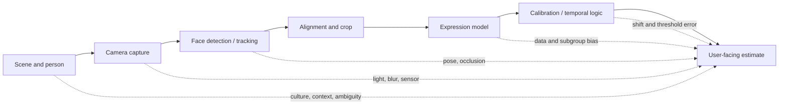

# Technical Limitations of Mobile Facial Expression Recognition

## Document control

| Field | Value |
| --- | --- |
| Milestone | 1.0 — Technical Discovery & Validation |
| Research snapshot | 2026-08-04 |
| Scope | Scientific and engineering limitations; no implementation design selected |
| Governing principle | An uncertain or unsupported input must be allowed to produce “unavailable” [P01] |

See the [Literature Review](FER_LITERATURE_REVIEW.md), [Research Gaps](RESEARCH_GAPS.md), [Mobile FER Overview](MOBILE_FER_OVERVIEW.md), and [References](REFERENCES.md).

## Limitation model

FER is a cascade. A classifier cannot recover information lost by capture, detection, crop, or alignment, and a technically accurate expression label still may not describe the user’s felt emotion.

Each limitation below separates established evidence, project assumptions, engineering trade-offs, and validation questions.

## Lighting and exposure

### Facts

- Underexposure reduces texture and landmark visibility; overexposure saturates regions and removes gradients. Directional light creates shadows that can resemble or hide expression-related creases.
- In-the-wild datasets contain illumination variation, but dataset coverage does not guarantee robustness to a target phone’s HDR, exposure, white balance, or low-light processing [R09][R11][R21].
- Apple and cloud services expose brightness/exposure or holistic face-quality indicators precisely because capture quality affects downstream facial analysis [R45][R52].

### Practical implications

- Gate analysis on measured brightness, blur, detector confidence, and face size rather than classifier confidence alone.
- Test warm indoor, daylight, backlit, side-lit, screen-lit, and low-light conditions on physical devices.
- Treat camera auto-exposure transitions as temporal disturbances; avoid displaying rapid label changes during adjustment.

### Assumptions and trade-offs

- **Assumption:** The initial flow can guide a consenting user toward acceptable lighting.
- **Trade-off:** Aggressive quality thresholds reduce false interpretations but increase unavailable results, potentially unevenly by skin tone and camera.
- **Open question:** Which quality signals predict FER error without themselves introducing demographic disparity?

## Occlusion

### Facts

Masks, glasses, hands, hair, facial hair, clothing, and cropped image boundaries conceal different facial regions. Mouth occlusion particularly affects smiles and surprise; eye/brow occlusion affects fear, anger, and sadness cues. Attention to multiple regions may add resilience but cannot reconstruct absent evidence [R15][R16].

### Practical implications

- Detect or estimate region visibility and fail unavailable when required regions are missing.
- Include naturally occurring and synthetic occlusion in evaluation, but do not treat synthetic augmentation as deployment proof.
- Do not silently infer behind masks or glasses from demographic or contextual shortcuts.

### Assumptions and trade-offs

- **Assumption:** Version 1 does not need to classify heavily occluded faces.
- **Trade-off:** Landmark/attention models may tolerate partial occlusion at higher compute and complexity.
- **Open question:** Are per-region visibility gates more equitable and stable than a single face-quality score?

## Head pose and alignment

### Facts

Yaw, pitch, and roll change apparent geometry, self-occlude features, and distort fixed crops. Alignment reduces nuisance variation but depends on reliable landmarks; frontalization can introduce artifacts. Pose remains a documented FER challenge and a standard face-analysis output [R05][R06][R45][R50].

### Practical implications

- Define a tested pose envelope rather than claiming arbitrary-view support.
- Preserve aspect ratio and enough facial context; avoid crop jitter and partial chin/forehead removal.
- Measure classifier behavior separately for frontal, moderate yaw/pitch, and outside-envelope inputs.

### Assumptions and trade-offs

- **Assumption:** A short foreground reflection can request a near-frontal pose without imposing perfect stillness.
- **Trade-off:** Strict pose gates improve input consistency but reduce accessibility and naturalness.
- **Open question:** Does landmark alignment improve target-domain accuracy enough to offset added latency and landmark failure?

## Age variation

### Facts

Facial morphology, skin texture, expressiveness, and camera behavior vary with age. Many datasets are web-scraped and do not establish balanced, accurately labeled age coverage [R09][R21][R22]. Children are excluded from initial project scope [P01], but adult age variation remains material.

### Practical implications

- Report adult age-band metrics where lawful, ethically collected, and statistically meaningful.
- Avoid using an inferred age attribute as a substitute for consented demographic evaluation.
- Include age-related accessibility considerations, such as device distance, glasses, tremor, or slower expression transitions.

### Assumptions and trade-offs

- **Assumption:** Initial evaluation covers adults only, consistent with the PRD.
- **Trade-off:** Collecting age-band metadata improves slice analysis but increases sensitive-data governance.
- **Open question:** What age bands can be evaluated without producing small, re-identifiable groups?

## Ethnicity, skin tone, and cultural variation

### Facts

- Dataset composition and conditional label distributions vary by collection source and culture [R21].
- Fairness research finds that augmentation or aggregate balancing alone does not necessarily eliminate FER disparities [R22].
- Human interpretation of facial expressions varies with cultural background and masking conditions, so annotator culture is part of the label-generation process [R23].
- Ethnicity, nationality, race, and skin tone are not interchangeable variables.

### Practical implications

- Evaluate performance, calibration, abstention, and false-high-confidence rates by ethically justified slices.
- Prefer directly relevant capture measures (for example, illumination/skin-tone interaction) over inferred ethnicity.
- Include intersectional analysis where sample sizes support it; publish uncertainty intervals and suppress unsafe small cells.
- Do not “correct” a face based on demographic stereotypes.

### Assumptions and trade-offs

- **Assumption:** Target-user evaluation must include East African users and intended launch populations rather than relying only on US/European web datasets.
- **Trade-off:** Better fairness evidence requires sensitive metadata and broader recruitment, increasing consent, security, and cost obligations.
- **Open question:** Which demographic and contextual variables are necessary, proportionate, and legally supportable for validation?

## Dataset bias and domain shift

### Facts

FER datasets differ in posed/spontaneous behavior, search keywords, camera quality, compression, label ontology, identity distribution, class balance, culture, and annotation process. Cross-dataset research demonstrates strong built-in bias and distribution mismatch [R09][R10][R21]. Under dataset shift, predictive uncertainty methods can degrade and require explicit evaluation [R25].

### Practical implications

- Split by identity and source; detect duplicates; prevent near-identical frames crossing train/test.
- Report in-domain, cross-dataset, and target-device/user results separately.
- Create a deployment-domain validation set under approved consent and governance; do not train on its final test partition.
- Version preprocessing with the model because crop changes create a new input distribution.

### Assumptions and trade-offs

- **Assumption:** No single public dataset is sufficient release evidence.
- **Trade-off:** Combining datasets increases diversity but introduces conflicting ontologies, licenses, and annotations.
- **Open question:** Which dataset combination and re-labeling protocol offers acceptable provenance and construct consistency?

## Expression ambiguity and construct validity

### Facts

- A facial configuration can occur with multiple emotions, social intentions, speech movements, or no corresponding felt emotion; context materially affects interpretation [R07].
- RAF-DB annotators identify compound expressions, and uncertainty-aware/open-set work exists because fixed single labels are incomplete [R10][R18][R19].
- A person can intentionally pose an expression; AWS explicitly warns that appearance is not internal emotional state [R48].

### Practical implications

- Phrase outputs as estimates of facial expression, never detected truth.
- Offer correction, dismissal, and “none of these” paths.
- Include an abstention state and avoid forced top-1 labels.
- Evaluate agreement with both multi-rater expression labels and user self-report without treating either as infallible.

### Assumptions and trade-offs

- **Assumption:** User reflection and self-report take precedence over automated output [P01].
- **Trade-off:** Multi-label or distribution outputs better represent ambiguity but are harder to communicate.
- **Open question:** Does showing probabilities help calibrated understanding, or create false numerical authority?

## Real-time constraints

### Facts

End-to-end latency includes camera delivery, conversion, detection, landmarks/alignment, classification, post-processing, and rendering—not just model invocation. Throughput and latency are different: a queued pipeline can report high throughput while showing stale results. Official LiteRT guidance recommends measuring startup, warm-up, steady-state inference, and memory on target devices [R37][R38].

### Practical implications

- Measure capture-to-result age, p50/p95 latency, dropped frames, queue depth, and UI frame timing.
- Use newest-frame semantics and bounded work queues.
- Benchmark cold start and first-result time separately from steady state.
- Make preview cadence independent from inference cadence.

### Assumptions and trade-offs

- **Assumption:** Reflection feedback can be responsive without classifying at camera frame rate.
- **Trade-off:** Lower cadence saves resources but may miss short transitions; smoothing improves stability but adds delay.
- **Open question:** What latency and temporal stability do users perceive as helpful rather than distracting?

## Mobile hardware variability

### Facts

Mobile CPUs, GPUs, NPUs/DSPs, memory bandwidth, delegate/operator support, OS versions, drivers, and background workloads vary widely. A delegate can accelerate one graph and slow another through partitioning or transfer overhead; Google recommends benchmarking each delegate and notes small models may not benefit from GPU delegation [R37].

### Practical implications

- Establish baseline, mid-tier, and upper-tier physical devices for both platforms.
- Record CPU/GPU/NPU path, thread count, model precision, OS, temperature, and power state with every benchmark.
- Define deterministic fallback and unavailable behavior for unsupported delegates/operators.
- Avoid using FLOPs or parameter count as a substitute for measured latency.

### Assumptions and trade-offs

- **Assumption:** The supported-device matrix will be narrower than “all devices that can install the app.”
- **Trade-off:** Broad device support increases access but forces smaller models, lower cadence, or tiered capability.
- **Open question:** Should unsupported devices lose live analysis, use a lower cadence/model, or disable the feature entirely?

## Battery usage

### Facts

Camera, image conversion, CPU/GPU/NPU inference, display, and memory traffic all consume energy. Higher thread counts may reduce latency while increasing resource and power use [R33][R37]. Model-only energy measurements omit much of the application cost.

### Practical implications

- Measure energy for the complete foreground session, including preview and rendering.
- Compare joules per accepted estimate and battery percentage over a defined session—not only watts during inference.
- Stop capture and release native resources immediately when the flow ends or the app leaves an allowed lifecycle state [P01][P02].
- Avoid background capture and unbounded “always on” analysis.

### Assumptions and trade-offs

- **Assumption:** Sessions are brief, explicit, and foreground-only.
- **Trade-off:** Hardware acceleration can lower time-to-result but may not always lower total energy.
- **Open question:** What session duration and cadence meet value goals without material battery drain?

## Thermal throttling

### Facts

Sustained camera and inference load heats mobile devices. Operating systems reduce CPU/GPU frequency or alter scheduling when thermal limits are reached, so short benchmarks can overstate sustained performance [R33][R37]. Ambient temperature, case, charging, and battery health affect results.

### Practical implications

- Run cold and sustained benchmarks, including warm ambient and charging scenarios.
- Record time series for latency, frame rate, temperature/thermal state, and power.
- Define graceful cadence reduction or unavailable behavior before severe throttling.
- Test repeated sessions, not only one launch.

### Assumptions and trade-offs

- **Assumption:** Adaptive cadence is acceptable if it does not change score semantics silently.
- **Trade-off:** Sustained peak speed improves responsiveness briefly but can degrade later sessions and user comfort.
- **Open question:** Which platform thermal signals are stable enough to drive a cross-platform policy?

## Camera quality differences

### Facts

Front cameras differ in resolution, optics, focus, noise reduction, HDR, rolling shutter, field of view, mirroring, color processing, and low-light behavior. Nominal megapixels do not predict FER input quality. Preprocessing pipelines can introduce rotation, crop, color-range, or channel-order errors.

### Practical implications

- Test front-camera streams, not gallery images alone.
- Validate rotation, mirroring, pixel format, color conversion, crop coordinates, and tensor normalization with golden fixtures.
- Evaluate face pixel size and motion blur at realistic hand-held distances.
- Keep preprocessing/model contracts versioned and checksummed [P02].

### Assumptions and trade-offs

- **Assumption:** Front-camera selfie distance is the initial capture context.
- **Trade-off:** Higher input resolution preserves detail but increases camera, conversion, memory, and inference cost.
- **Open question:** What minimum face pixel size is required for each candidate model and expression class?

## Confidence, calibration, and failure detection

### Facts

Softmax output is not automatically a calibrated probability. Temperature scaling can improve in-domain calibration, while dataset shift still degrades uncertainty quality [R24][R25]. Maximum-score thresholding alone does not detect every out-of-distribution or corrupted input [R26].

### Practical implications

- Evaluate expected calibration error with caution, reliability diagrams, Brier or log loss, classwise calibration, selective risk, coverage, and false-high-confidence errors.
- Calibrate after quantization and preprocessing are finalized; optimization can alter logits.
- Use layered failure detection: input quality, face presence/pose/visibility, classifier confidence, open-set/OOD signal, and temporal consistency.
- Set thresholds against harm-weighted validation outcomes, not round numbers.

### Assumptions and trade-offs

- **Assumption:** Abstention coverage is a product metric, not a defect to hide.
- **Trade-off:** Raising thresholds lowers coverage and may improve accepted-result precision, but may worsen access or subgroup disparities.
- **Open question:** What selective-risk target and minimum subgroup coverage are acceptable?

## Summary risk matrix

| Limitation | Likelihood | Potential impact | Discovery priority | Primary evidence needed |
| --- | --- | --- | --- | --- |
| Construct ambiguity | Certain | Critical | Highest | User research, claim review, multi-rater/self-report study |
| Dataset/domain shift | High | Critical | Highest | Cross-dataset and target-domain evaluation |
| Fairness disparity | High | Critical | Highest | Slice quality, calibration, coverage, confidence intervals |
| Poor lighting/occlusion/pose | High | High | High | Factorial robustness tests and quality gates |
| Miscalibration/OOD | High | High | High | Reliability/selective-risk/OOD tests after optimization |
| Hardware variability | High | High | High | Physical device matrix benchmarks |
| Thermal/battery cost | Medium–high | High | High | Sustained end-to-end energy/thermal tests |
| Camera/preprocessing drift | Medium–high | High | High | Golden tensor parity and multi-camera evaluation |

Likelihood and impact are project risk assessments, not measured probabilities.

## Project-wide evidence summary

### Facts

- Real-world FER failure is jointly caused by signal quality, pipeline behavior, dataset shift, label ambiguity, and hardware constraints.
- Aggregate accuracy and single-device latency cannot establish release readiness.
- Reliable unavailability behavior is as important as accepted-result accuracy [P01].

### Assumptions

- The initial experience can constrain capture to one consenting, near-frontal adult in a short session.
- Target-domain validation data can be collected under separate governance before release.

### Trade-offs

- Wider operating envelope versus safer abstention.
- Cross-platform sameness versus native optimization.
- Richer temporal/context input versus privacy, compute, and interpretability.

### Open questions

- What exact capture envelope, device baseline, and session duration will be supported?
- How will the project define unacceptable subgroup disparity and uncertainty?
- Which failures are recoverable with user guidance, and which must end analysis?
- How will user correction inform reflection without becoming unconsented model-training data?

## Related documents

- [FER Literature Review](FER_LITERATURE_REVIEW.md)
- [Existing Solutions](EXISTING_SOLUTIONS.md)
- [Research Gaps](RESEARCH_GAPS.md)
- [Mobile FER Overview](MOBILE_FER_OVERVIEW.md)
- [References](REFERENCES.md)
